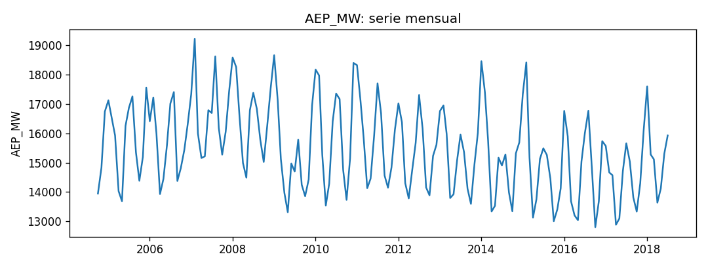
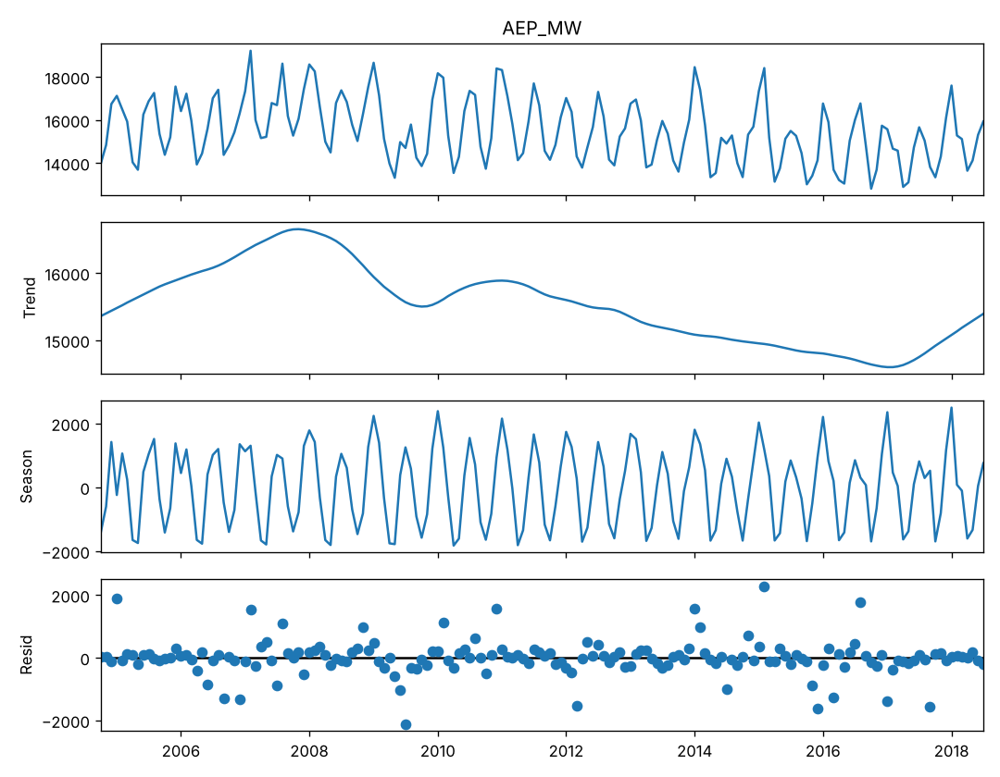
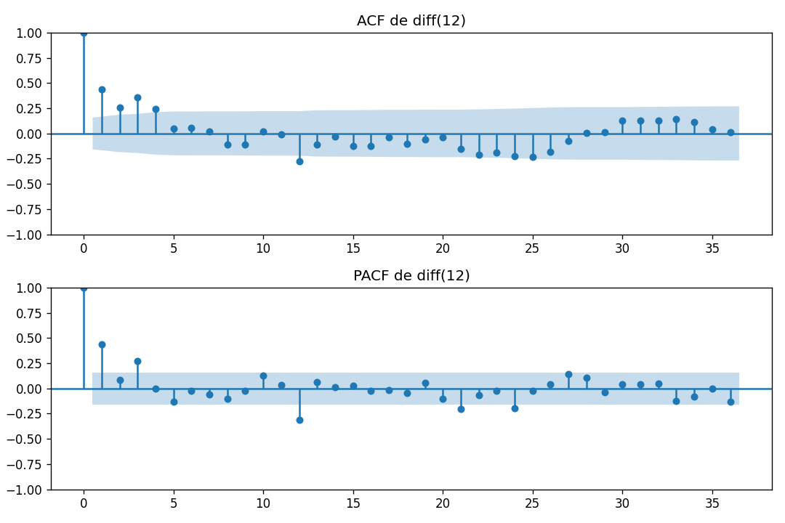
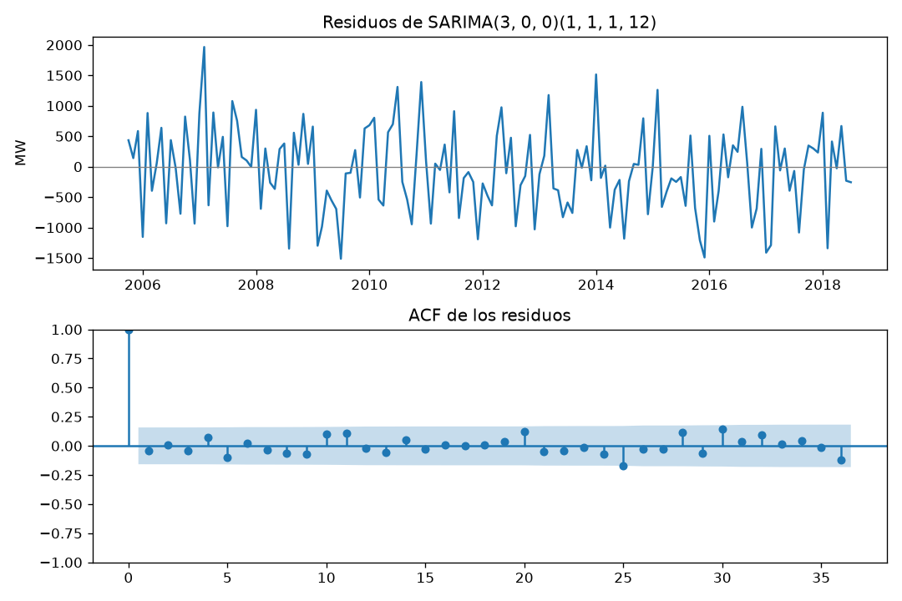

# Informe del miniproyecto 1

Llene cada sección reemplazando los marcadores `{{...}}`, sin quitar las
secciones. Las cifras salen de lo que imprime `python miniproyecto.py` y las
figuras son las que ese guion deja en `figuras/`. Las fórmulas van en LaTeX
(`$...$` o `$$...$$`).

## 1. La serie

La serie es la carga eléctrica media por hora de cada mes en la zona de
American Electric Power (AEP), una de las zonas de la red de PJM en el
oriente de Estados Unidos, medida en MW. Sale del conjunto de Kaggle
[robikscube/hourly-energy-consumption](https://www.kaggle.com/datasets/robikscube/hourly-energy-consumption)
(Rob Mulla, datos originales de PJM), con licencia CC0: Public Domain. La
fuente es horaria. La agregamos a frecuencia mensual promediando las horas
de cada mes:

$$y_t = \frac{1}{H_t}\sum_{i=1}^{H_t} x_{t,i},$$

donde $x_{t,i}$ es la carga de la hora $i$ del mes $t$ y $H_t$ el número de
horas del mes. La serie va de octubre de 2004 a julio de 2018: 166
observaciones. La elegimos porque es pública, tiene 166 meses (el mínimo es
60) y muestra dos picos al año: uno en invierno, por la calefacción, y otro en
verano, por el aire acondicionado. El valor más alto es febrero de 2007, con
19 213 MW, y el más bajo octubre de 2016, con 12 805 MW.

### Huecos

La serie mensual no tiene meses vacíos: el guion reporta `0
vacíos`. Las únicas decisiones sobre huecos se toman al agregar los datos
horarios, en `datos/preparar_aep.py`. Las horas duplicadas por el cambio de
horario de verano se promedian. Además, se descarta agosto de 2018, que solo
tiene 49 horas: un promedio de dos días no representa el mes y quedaría
sesgado. Por eso la serie termina en julio de 2018. Aun así, `preparar`
interpola linealmente cualquier NaN para que el *backtest* nunca reciba
huecos.

### Datos atípicos

Para buscar atípicos sin depender todavía de ningún modelo, `preparar`
compara cada mes con el mismo mes del año anterior y del siguiente:

$$a_t = y_t - \frac{y_{t-12} + y_{t+12}}{2}.$$

Como la carga depende del clima, $a_t$ mide cuánto se aparta un mes de lo
que fue ese mismo mes en los años vecinos. Se puede calcular en 142 meses (los
12 primeros y los 12 últimos no tienen vecinos) y su desviación estándar es
757 MW. Marcamos como atípico un mes con $\lvert a_t \rvert$ mayor que 3
desviaciones estándar, y solo hay uno: julio de 2009, con 14 697 MW frente a
17 360 MW de los julios vecinos ($-2\,663$ MW, $-3{,}5$ desviaciones). Los
siguientes ya quedan por debajo del umbral: diciembre de 2010 (+1 859 MW,
+2,5), febrero de 2015 (+1 760 MW, +2,3) y julio de 2008 (+1 681 MW, +2,2).

Decidimos conservar julio de 2009. No es un error de medición: es la carga
que hubo ese mes, en pleno verano.
No tenemos una fuente sobre el clima de ese mes, así que no le atribuimos una
causa. Quitarlo o suavizarlo haría que la serie se viera más regular de lo
que es, y el modelo no aprendería que hay veranos con mucha menos carga de la
esperada. La decisión queda en la columna `decision` de la tabla: *sin huecos
(ago-2018 incompleto se descarta al agregar); el atípico de jul-2009 se
conserva porque es demanda real*.

## 2. Componentes

La STL descompone la serie en forma aditiva,

$$y_t = T_t + S_t + R_t,$$

con tendencia $T_t$, estacionalidad $S_t$ y residuo $R_t$. Usamos
`period=12` porque la serie es mensual y el ciclo se repite cada año, y
`robust=True` para que los atípicos no deformen $T_t$ ni $S_t$.

### Tendencia

- Empieza en 15 357 MW en octubre de 2004 y sube hasta un máximo de 16 654 MW
  en noviembre de 2007.
- Cae hasta 15 500 MW en octubre de 2009, en los años de la recesión de
  2008-2009, y repunta a 15 887 MW en enero de 2011.
- Después baja de forma sostenida hasta su mínimo, 14 598 MW en enero de 2017.
- La subida final hasta 15 393 MW está en el borde de la serie, donde la STL
  es menos confiable.

En total, la tendencia se mueve unos 2 000 MW en catorce años, menos que la
amplitud estacional.

### Estacionalidad

Hay dos picos al año. El de invierno es el mayor: enero
queda 1 726 MW por encima de la tendencia (el mes más alto), seguido de
febrero (+1 102 MW) y diciembre (+1 042 MW). El de verano lo marca julio
(+1 086 MW), seguido de agosto (+661 MW). Los meses más bajos son los
templados: abril (−1 689 MW, el más bajo), octubre (−1 569 MW) y mayo
(−1 522 MW). Entre enero y abril hay 3 415 MW de diferencia.

### Residuo

La desviación estándar del residuo es 572 MW, y el 83 % de los
meses tiene un residuo menor de 500 MW en valor absoluto. El más grande es
febrero de 2015: la carga real fue 18 407 MW y la tendencia más la
estacionalidad daban 16 121 MW, un residuo de +2 286 MW. El siguiente es
julio de 2009, con 14 697 MW frente a 16 814 MW esperados (−2 116 MW). Les
siguen enero de 2005 (+1 881 MW), agosto de 2016 (+1 782 MW) y diciembre de
2015 (−1 623 MW).

Julio de 2009 es el mismo mes que la sección 1 marcó como atípico. Febrero de
2015, en cambio, no pasaba el umbral de la sección 1 porque febrero de 2014
también fue un mes de carga alta, pero frente a la tendencia y la
estacionalidad es el mes más extremo de la serie. Coincide con un frío
récord en la región: en el norte de Ohio, dentro del territorio de AEP, fue
el febrero más frío del que hay registro en casi todas las estaciones, con
temperaturas medias hasta 15 °F por debajo de lo normal
([NWS Cleveland, revisión del invierno 2014-15](https://www.weather.gov/cle/Climate_Winter_2014-15_Review)).
Con `robust=True`, estos dos meses pesan menos al estimar la tendencia y la
estacionalidad, y su efecto queda en el residuo.

## 3. Líneas base y backtest

El *backtest* es el común de `comun.py`, con origen móvil sobre los últimos 24
meses y horizonte de 1 a 12. Desde cada origen $T$, el modelo pronostica
$\hat y_{T+1}, \dots, \hat y_{T+12}$ y se compara con los 12 valores reales.
Con 166 meses hay $24 - 12 + 1 = 13$ orígenes, de julio de 2016 a julio de
2017. Los meses de prueba van de agosto de 2016 a julio de 2018, y el primer
origen todavía deja 142 meses para ajustar. No caben 24 orígenes porque cada
uno necesita 12 meses reales después de él. Ningún dato posterior al
origen entra al modelo: `backtest` le pasa a `modelo(entrenamiento, h)`
solo `serie.iloc[:corte]`, y los valores reales posteriores solo se usan para
calcular el error.

Las métricas de cada origen se promedian sobre los 13 orígenes:

$$\text{RMSE} = \sqrt{\frac{1}{12}\sum_{h=1}^{12}(y_{T+h}-\hat y_{T+h})^2},\qquad
\text{MAE} = \frac{1}{12}\sum_{h=1}^{12}\lvert y_{T+h}-\hat y_{T+h}\rvert,\qquad
\text{MAPE} = \frac{100}{12}\sum_{h=1}^{12}\left\lvert\frac{y_{T+h}-\hat y_{T+h}}{y_{T+h}}\right\rvert.$$

Las dos líneas base son el ingenuo, $\hat y_{T+h} = y_T$, y el estacional
ingenuo, $\hat y_{T+h} = y_{T+h-12}$ para $h \le 12$.

| Modelo | RMSE | MAE | MAPE (%) |
|---|---|---|---|
| Estacional ingenuo | 935,52 | 763,24 | 5,09 |
| Ingenuo | 1 641,37 | 1 385,72 | 9,52 |

El estacional ingenuo gana en las tres métricas: reduce el RMSE en un
43 %, el MAE en un 45 % y el MAPE en un 47 % frente al ingenuo. La razón está en
la sección 2: con 3 415 MW de diferencia entre enero y abril,
repetir el último valor durante 12 meses falla cada vez que el horizonte
cruza un pico o un valle. Copiar el mismo mes del año anterior, en cambio,
recoge los dos picos anuales. Su MAE dice que se equivoca en promedio en
763 MW de carga media por hora, y su MAPE que ese error es cerca del 5 % de
la carga real. Con un RMSE de 935,52, es la referencia para comparar los
modelos de la sección 5.

## 4. Estacionariedad e identificación

La prueba ADF estima

$$\Delta y_t = \alpha + \beta t + \gamma\, y_{t-1} + \sum_{j=1}^{k}\delta_j\,\Delta y_{t-j} + \varepsilon_t$$

con hipótesis nula $H_0: \gamma = 0$ (raíz unitaria, serie no estacionaria).
Un valor p menor que 0,05 rechaza $H_0$. La serie original tiene una
tendencia visible, así que se prueba con constante y tendencia
(`regression="ct"`, con el término $\beta t$). Las versiones diferenciadas ya
no la tienen y se prueban solo con constante (`regression="c"`, $\beta = 0$).

| Versión | d | D | `regression` | Valor p |
|---|---|---|---|---|
| Original | 0 | 0 | `ct` | 0,0858 |
| `diff(12)` | 0 | 1 | `c` | 0,0016 |
| `diff()` | 1 | 0 | `c` | 0,0012 |
| `diff(12).diff()` | 1 | 1 | `c` | 0,0003 |

La serie original no rechaza $H_0$ (0,0858 > 0,05). Las tres versiones
diferenciadas sí. La regla es elegir la combinación con menos diferencias
cuyo valor p quede bajo 0,05, y aquí empatan `diff()` y `diff(12)`, cada una
con una sola diferencia. Elegimos $d = 0$ y $D = 1$, es decir,
$w_t = (1 - B^{12})\,y_t = y_t - y_{t-12}$. Preferimos la diferencia
estacional porque la estacionalidad es el rasgo más marcado de la serie y
solo `diff(12)` la quita. Como la tendencia cambia despacio, esa misma
diferencia también elimina buena parte de ella. Agregar la diferencia regular
($d = D = 1$) bajaría el valor p, pero con el riesgo de sobrediferenciar.

En la ACF de $w_t$ salen de las bandas del 95 % los rezagos 1, 2, 3, 4 y
12. En la PACF salen los rezagos 1, 3, 12, 21 y 24.

| Rezago | ACF | PACF |
|---|---|---|
| 1 | +0,44 | +0,44 |
| 2 | +0,26 | +0,09 |
| 3 | +0,36 | +0,27 |
| 4 | +0,24 | −0,01 |
| 12 | −0,27 | −0,32 |
| 21 | −0,15 | −0,20 |
| 24 | −0,23 | −0,20 |
| 36 | +0,01 | −0,13 |

### Parte no estacional

La ACF es positiva y decae lentamente en los
primeros cuatro rezagos. La PACF, en cambio, tiene picos en los rezagos 1 y 3
y queda dentro de las bandas en el 2 y el 4. Ese patrón sugiere un término
autorregresivo de orden bajo, $p$ entre 1 y 3, con $q$ de 0 a 2 para
recoger lo que quede.

### Parte estacional

Después de `diff(12)`, la ACF tiene un pico negativo en
el rezago 12 (−0,27) y luego se apaga (+0,01 en el 36). La PACF es negativa
y decae en los rezagos estacionales (−0,32 en el 12, −0,20 en el 24 y −0,13
en el 36). Un pico aislado en el rezago 12 de la ACF, con una PACF que decae
en 12, 24 y 36, corresponde a un MA estacional de orden 1, frecuente después
de aplicar la diferencia estacional. Por eso proponemos $Q = 1$ y $P = 0$, sin
otra diferencia. La
rejilla de la sección 5 prueba estos órdenes alrededor de
$(p, 0, q)(0, 1, 1)_{12}$.

## 5. Modelos clásicos

### Rejilla por AIC

Con $d = 0$ y $D = 1$ fijos, la rejilla prueba $p$ de 0 a 3 y $q$ de 0 a 2,
por los picos de la PACF en los rezagos 1 y 3, y $P$ y $Q$ en 0 o 1, por el
pico del rezago 12. Son 48 modelos, ajustados sobre la serie en GW
(`ESCALA = 1000`): en MW la varianza del error queda en cientos de miles y,
como vimos en el taller 2, el optimizador termina en una solución peor. $d$ y $D$ no entran a la rejilla:
cambian la serie que se modela, y el AIC de series distintas no se compara.

$$\text{AIC} = -2\ln L + 2k,$$

con $L$ la verosimilitud y $k$ el número de parámetros. Los diez de menor AIC:

| | `order` | `seasonal_order` | AIC |
|---|---|---|---|
| 1 | (3, 0, 0) | (1, 1, 1, 12) | 335,85 |
| 2 | (3, 0, 1) | (1, 1, 1, 12) | 337,43 |
| 3 | (1, 0, 1) | (1, 1, 1, 12) | 337,68 |
| 4 | (1, 0, 2) | (1, 1, 1, 12) | 338,52 |
| 5 | (3, 0, 2) | (1, 1, 1, 12) | 338,86 |
| 6 | (2, 0, 1) | (1, 1, 1, 12) | 338,92 |
| 7 | (2, 0, 2) | (1, 1, 1, 12) | 339,85 |
| 8 | (3, 0, 0) | (0, 1, 1, 12) | 339,89 |
| 9 | (1, 0, 1) | (0, 1, 1, 12) | 341,15 |
| 10 | (1, 0, 2) | (0, 1, 1, 12) | 341,17 |

Gana $\text{SARIMA}(3, 0, 0)(1, 1, 1)_{12}$. Los siete primeros tienen
$P = Q = 1$: en la sección 4 propusimos $P = 0$, pero el término AR
estacional baja el AIC en unos 4 puntos (339,89 con $P = 0$ frente a 335,85).
Las diferencias entre los cinco primeros son menores de 3 puntos, así que
varios modelos ajustan casi igual; el AR(3) es además el que corresponde a
los picos de la PACF en los rezagos 1 y 3.

### El modelo elegido

Con $B$ el operador de rezago ($B^k y_t = y_{t-k}$), el modelo es

$$(1 - \phi_1 B - \phi_2 B^2 - \phi_3 B^3)(1 - \Phi_1 B^{12})(1 - B^{12})\,y_t = (1 + \Theta_1 B^{12})\,\varepsilon_t,$$

y con los coeficientes estimados (serie en GW):

| Coeficiente | Valor | Valor p |
|---|---|---|
| $\phi_1$ (`ar.L1`) | +0,405 | 0,000 |
| $\phi_2$ (`ar.L2`) | +0,058 | 0,532 |
| $\phi_3$ (`ar.L3`) | +0,268 | 0,003 |
| $\Phi_1$ (`ar.S.L12`) | +0,269 | 0,013 |
| $\Theta_1$ (`ma.S.L12`) | −0,969 | 0,015 |
| $\sigma^2$ | 0,417 GW² | |

$\phi_1$ y $\phi_3$ son significativos y $\phi_2$ no, lo mismo que mostró la
PACF: barras en los rezagos 1 y 3 y nada en el 2. $\Theta_1 = -0{,}969$ está
cerca de $-1$: la sorpresa de un mes se descuenta casi entera al pronosticar
el mismo mes del año siguiente, que es el pico negativo de $-0{,}27$ que tenía
la ACF en el rezago 12.

### Diagnóstico de los residuos

Se dejan por fuera los 12 primeros residuos, que salen de la diferencia
estacional y no son errores de pronóstico; quedan 154. La prueba de
Ljung-Box junta sus autocorrelaciones $r_k$ hasta el rezago $m$,

$$Q = n(n+2)\sum_{k=1}^{m}\frac{r_k^2}{n-k},$$

con hipótesis nula de que los residuos son ruido blanco.

| `lags` | $Q$ | Valor p |
|---|---|---|
| 12 | 8,56 | 0,740 |
| 24 | 14,38 | 0,938 |

Los dos valores p pasan de 0,05, así que no rechazamos la nula: no queda
estructura en el primer año ni en el segundo. En la ACF de los residuos
ninguna barra sale de las bandas del 95 %; la más grande es la del rezago
25 ($-0{,}17$), justo en el borde. La media es $-65$ MW y la desviación
estándar 691 MW, y el 86 % de los residuos queda por debajo de 1 000 MW en
valor absoluto. Los más grandes son febrero de 2007 (+1 966 MW, el valor más
alto de la serie), enero de 2014 (+1 515 MW) y julio de 2009 (−1 513 MW), el
atípico que conservamos en la sección 1.

### Contraste: el mismo modelo con $P = 0$

En la sección 4 propusimos $P = 0$ y la rejilla eligió $P = 1$. Para ver
qué se gana con ese término, el guion pasa también
$	ext{SARIMA}(3, 0, 0)(0, 1, 1)_{12}$ por el *backtest* común, como
experimento:

| Modelo | AIC | RMSE | MAE | MAPE (%) |
|---|---|---|---|---|
| $(3, 0, 0)(1, 1, 1)_{12}$, elegido | 335,85 | 770,97 | 606,25 | 4,12 |
| $(3, 0, 0)(0, 1, 1)_{12}$, contraste | 339,89 | 753,51 | 586,96 | 3,99 |

El AIC prefiere $P = 1$ y el *backtest* prefiere $P = 0$, por 19 MW de MAE
(un 3 %). No miden lo mismo: el AIC juzga el ajuste a toda la serie,
castigado por el número de parámetros, y el *backtest* juzga los pronósticos
de 1 a 12 meses desde 13 orígenes. Mantenemos el modelo elegido por AIC en
la tabla de la sección 6 porque la regla de selección se fijó antes de mirar
el *backtest*. Elegir ahora $P = 0$ por su error de prueba sería usar los
datos de prueba para seleccionar el modelo, y su error dejaría de ser una
medida honesta de cómo pronostica. El contraste sí dice algo útil: el
término AR estacional ($\Phi_1 = 0{,}269$) mejora el ajuste pero no los
pronósticos en estos dos años.

### La variable exógena

La exógena $x_t$ es el número de festivos federales de Estados Unidos en el
mes $t$, del paquete `holidays` (AEP atiende estados del oriente de ese
país). Incluye los días trasladados ("observed"), como el lunes 2 de enero de
2017, cuando el 1 cayó en domingo. En promedio hay 2,33 festivos en
noviembre, 2,20 en enero y 1,47 en diciembre, y ninguno en marzo, abril,
junio y agosto. El SARIMAX la agrega al modelo elegido:

$$y_t = \beta\, x_t + \eta_t, \qquad \eta_t \sim \text{SARIMA}(3, 0, 0)(1, 1, 1)_{12}.$$

Se conoce de antemano porque el calendario de festivos se fija con años de
anticipación. Por eso no hay fuga en el *backtest*: en cada origen el modelo
se ajusta con `x.loc[entrenamiento.index]` y pronostica con
`x.loc[fechas_siguientes(entrenamiento, h)]`, los festivos de los 12 meses
siguientes, que salen del calendario y no de la serie. Si usáramos una
variable que solo se conoce al terminar el mes, como la temperatura, habría
que pronosticarla también; tomar su valor real sería usar información
posterior al origen.

Con toda la serie, $\beta = +0{,}105$ GW, unos 105 MW más de carga media por
cada festivo adicional, con valor p 0,397: no se distingue de cero. El AIC
pasa de 335,85 a 337,36, así que el parámetro extra no compensa. Los
festivos se concentran en enero, noviembre y diciembre, meses de carga alta
que la parte estacional del SARIMA ya recoge, y un festivo cambia poco el
promedio de un mes de 30 días. En el *backtest* tampoco ayuda: el SARIMAX
tiene un MAE de 622,35 MW frente a 606,25 del SARIMA (sección 6).

## 6. Tabla de métricas

{{Copie aquí `resultados/metricas.csv` como tabla de Markdown, ordenada por
RMSE.}}

| Modelo | Decisión | RMSE | MAE | MAPE (%) |
|---|---|---|---|---|
| {{...}} | {{...}} | {{...}} | {{...}} | {{...}} |

## 7. Conclusión

{{El mejor modelo clásico, cuánto mejora a la mejor línea base en cada
métrica y en qué meses o tramos sigue fallando. Es el modelo que el
miniproyecto 2 debe superar.}}
